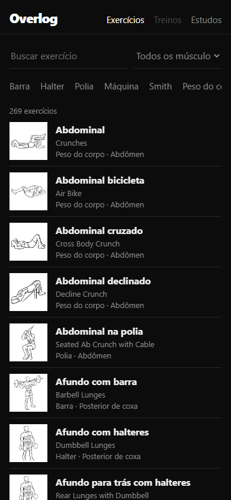
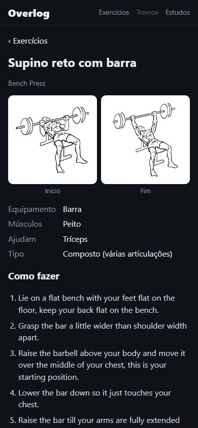
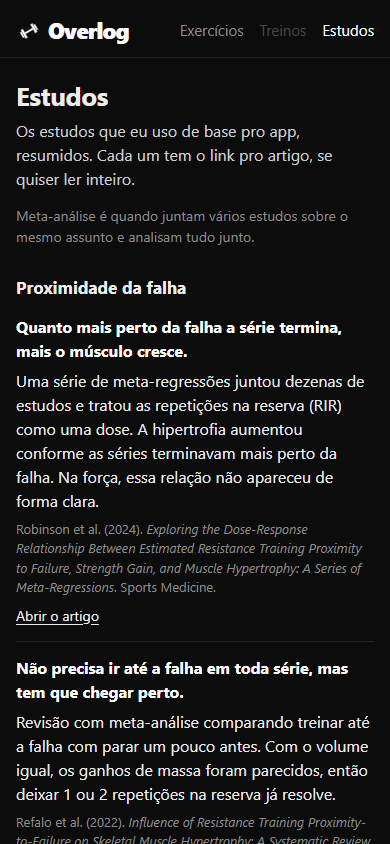

# Overlog

[](https://github.com/ViniciuscLemos/overlog/actions/workflows/deploy.yml)

A gym log I'm making for myself. The name comes from progressive overload + log.

Live at https://viniciusclemos.github.io/overlog/ (on the phone, "Add to Home Screen" installs it and it works offline).

<p>
  
  
  
</p>

## Why

I lift and I write down every set. The apps I tried either lock things behind a subscription (Hevy's free plan only lets you save 4 routines, which doesn't work for an ABCDE split), need internet in the middle of the gym, or are full of points and badges I don't care about.

What actually makes a muscle grow is getting close to failure and adding weight or reps over time, so that's what this app is built around: each set gets weight, reps and how many reps you had left (RIR), and the app shows what you did last time.

## What it does so far

269 exercises, each with a drawing of the start and end of the movement. I didn't want photos of people, and these drawings all have the same style. 236 of them already have the name we use in Brazilian gyms (supino reto, puxada com triângulo, remada cavalinho...) with the English name under it, and the search understands words like "rosca" or "halter" in the ones that don't yet.

The search ignores accents and word order, so "supino halteres" and "dumbbell bench" both work, and you can filter by equipment and muscle.

The Workouts tab is where you set up your split: as many workouts as you want, in the order you do them. They rotate (after the last one comes the first again) instead of being tied to days of the week, so a 4-day upper/lower doesn't have to fit Monday to Thursday. Each exercise starts at 2 sets of 5 to 9 reps with 3 minutes of rest, and everything can be changed, with a note for things like seat height. At the bottom it adds up the sets per muscle, and a workout can be copied to start the next one.

There's also a tab with the studies behind the app (proximity to failure, progression, volume, frequency, rest, protein), summed up in Portuguese with a link to each paper. I checked every DOI before adding it, and the RIR scale paper the app is based on is there too.

## Next

Logging a workout with weight, reps and RIR, a suggestion of what to do next time, history and a chart per exercise. After that, rest timer, your own exercises and backup.

The exercises that don't have a drawing (wide-grip pulldown, hip thrust...) will come in with a black and white muscle map in the same line style, so the pictures keep looking the same.

Everything is saved on the phone (IndexedDB), no account.

## Running it

```bash
npm install
npm run dev
npm test
```

The exercise list is built from Everkinetic's data by `scripts/import-exercises.mjs` (how to run it is at the top of the file). The Portuguese names are in `scripts/names-pt.json`.

## Credits

Exercises and drawings by [Everkinetic](https://github.com/everkinetic/data), under [CC BY-SA 4.0](https://creativecommons.org/licenses/by-sa/4.0/). The drawings are loaded from their repository, and `src/data/exercises.json` (made from their data) keeps that license. The rest of the code is MIT.
